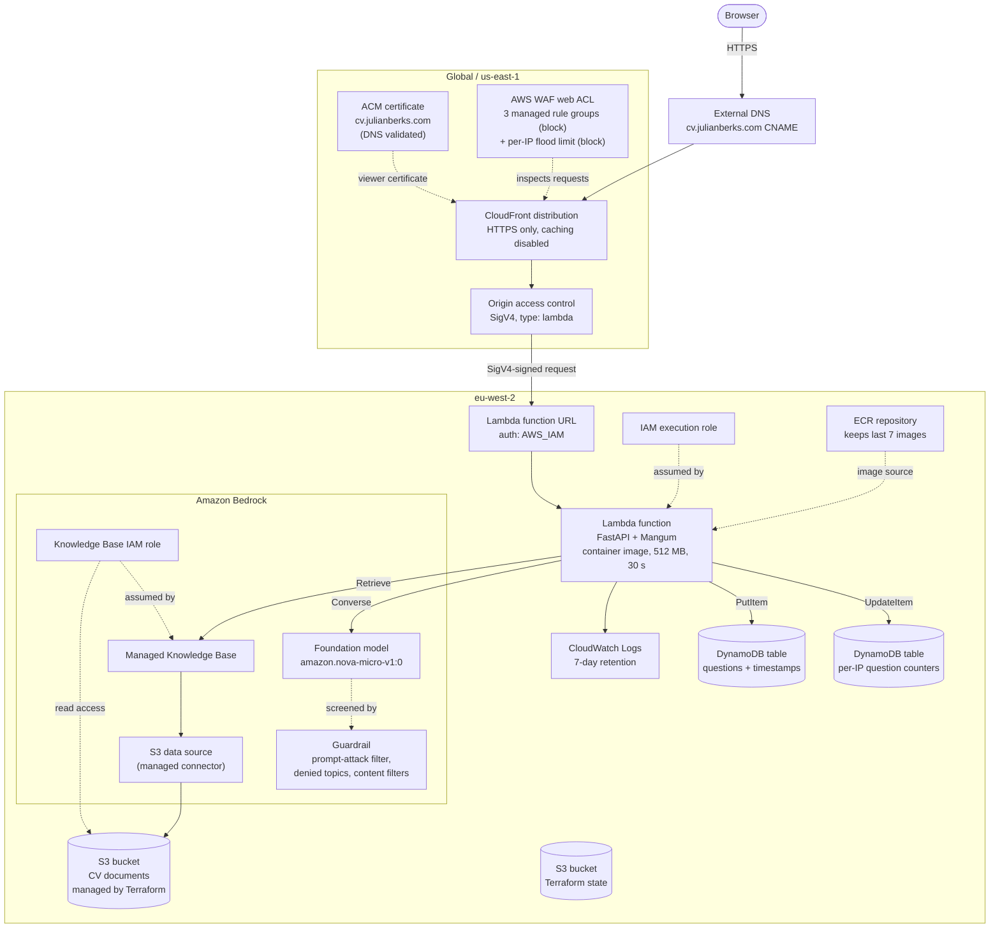
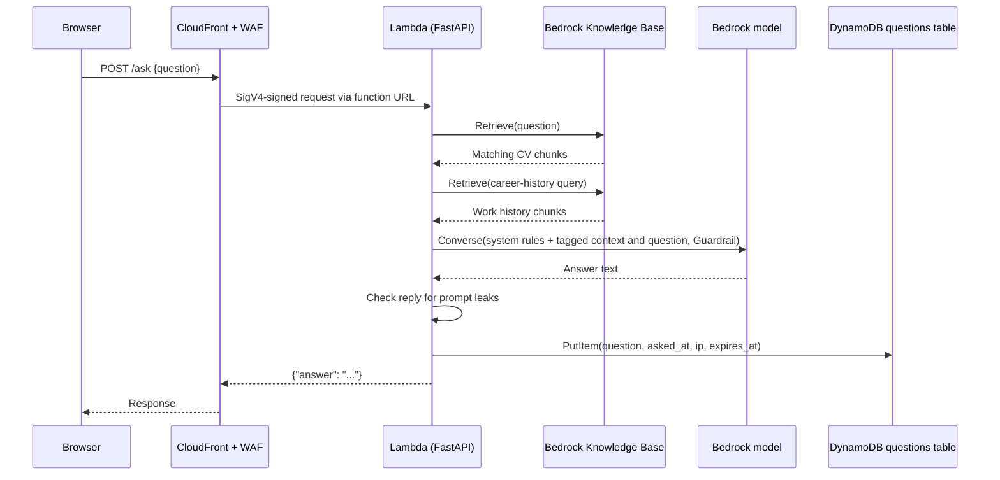
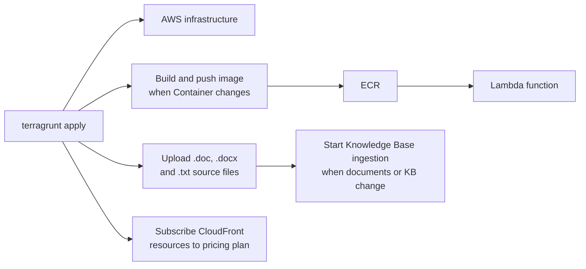

# CV App Architecture

A chat page that answers questions about Julian's CV. A FastAPI app runs as a container image on AWS Lambda, behind CloudFront. Answers are generated by Amazon Bedrock from a Knowledge Base built over CV documents in S3.

For running and deploying the app, see the [README](../../../../README.md).

## AWS architecture



Terragrunt runs the Terraform root module in `cv/app`. Terraform state is stored in the existing S3 state bucket; Terraform creates the RAG bucket and uploads supported CV source documents to it.

## Request flow

1. The browser requests `https://cv.julianberks.com/`. External DNS resolves the name to the CloudFront distribution.
2. The WAF web ACL evaluates the request. Its managed rule groups use their own block actions, so matching requests get a 403 and never reach Lambda. A rate-based rule blocks any IP address that makes more than 100 requests of any kind in 5 minutes (`waf_requests_per_5_minutes`); blocked requests get a 403 and never reach Lambda. The Free plan only supports plain per-IP limits over 5 minutes, so this is a flood backstop, not the per-question limit.
3. CloudFront terminates TLS using the ACM certificate and forwards the request to the Lambda function URL. Caching is disabled, so every request reaches Lambda.
4. CloudFront signs the origin request with SigV4 through the origin access control. The function URL uses `AWS_IAM` authorization, and a Lambda resource policy allows only this distribution to invoke it. Direct calls to the function URL are rejected.
5. Mangum adapts the Lambda event to ASGI and FastAPI handles it:
   - `GET /` returns `static/index.html`, which loads Vue 3 from a CDN and `static/app.js`.
   - `POST /ask` runs the question through Bedrock and returns `{"answer": "..."}`.
6. For `/ask`, `answer_question()` in [app.py](../app.py):
   1. Calls `bedrock-agent-runtime` `Retrieve` on the Knowledge Base twice, using `managedSearchConfiguration` to request up to `RETRIEVAL_RESULTS` (default 20) chunks each time: once with the question, and once with a fixed career-history query. The second search makes sure questions about roles and dates see the whole work history, not just the chunks that match the wording of the question. Duplicate chunks are removed.
   2. Strips prompt delimiter tags (`<context>`, `<question>`, `<system>` and similar) from the question and chunks, so neither can close or fake the tags the prompt relies on, then wraps the chunks in `<context>` and the question in `<question>`.
   3. Calls `bedrock-runtime` `Converse` with the rules in the `system` field and the tagged text in the user turn, with `temperature` 0 and `maxTokens` 300. The system prompt includes today's date so that questions such as "in the last 5 years" can be answered. The question is sent as a `guardContent` block, and the Guardrail is applied through `guardrailConfig`.
   4. Checks the reply. If it contains a leak marker (a secret canary string in the system prompt, or the prompt's tags), or it starts with the standard refusal, the reply is replaced with the refusal message alone.
7. After Bedrock answers, `record_question()` writes the question, a UTC timestamp and the visitor's IP address (the last `X-Forwarded-For` entry, which CloudFront appends) to the DynamoDB questions table. Each item has an `expires_at` time, after which DynamoDB deletes it. If the write fails, the error is logged and the user still gets their answer. Nothing is written when Bedrock fails.
8. The answer is returned to the browser and shown in the chat. Each question is independent; no conversation history is sent to the model.



## Components

| Component | Purpose | Defined in |
| --- | --- | --- |
| ACM certificate | TLS certificate for the domain, created in `us-east-1` (required by CloudFront) and validated with a DNS record you create externally | [cloudfront.tf](../../cloudfront.tf) |
| CloudFront distribution | Public HTTPS entry point for the custom domain; uses the managed `CachingDisabled` cache policy and `AllViewerExceptHostHeader` origin request policy | [cloudfront.tf](../../cloudfront.tf) |
| CloudFront origin access control | Signs requests to the Lambda function URL with SigV4 | [cloudfront.tf](../../cloudfront.tf) |
| CloudFront pricing plan | Subscribes the CloudFront distribution and WAF to the configured plan tier through the AWS CLI during apply | [cloudfront.tf](../../cloudfront.tf) |
| WAF web ACL | Runs the IP reputation, common, and known-bad-inputs AWS managed rule groups, plus a `RateLimitPerIP` rule. The 10-questions-per-minute limit is enforced in the app | [cloudfront.tf](../../cloudfront.tf) |
| Lambda permissions | Allow `cloudfront.amazonaws.com` to invoke the function URL, limited to this distribution | [cloudfront.tf](../../cloudfront.tf) |
| Lambda function | Runs the container image; environment variables include the Knowledge Base, model, Guardrail, DynamoDB tables, retention, origin, and question-rate settings. Reserved concurrency is configurable | [modules/lambda](../../modules/lambda/main.tf) |
| Lambda function URL | HTTPS endpoint for the function, with `AWS_IAM` authorization | [modules/lambda](../../modules/lambda/main.tf) |
| IAM execution role | Basic Lambda logging, scoped Bedrock permissions, and `PutItem`/`UpdateItem` access to the DynamoDB tables | [modules/lambda](../../modules/lambda/main.tf) |
| CloudWatch log group | Function logs, 7-day retention | [modules/lambda](../../modules/lambda/main.tf) |
| ECR repository | Stores immutable, source-digest-tagged Lambda images, scans on push, and keeps the latest 7 images | [modules/ecr](../../modules/ecr/main.tf) |
| Bedrock Guardrail | Applies prompt-attack, topic, insults, and hate filters. A pinned version is passed to the app | [guardrail.tf](../../guardrail.tf) |
| Bedrock Knowledge Base | Managed Knowledge Base used for retrieval | [modules/knowledge-base](../../modules/knowledge-base/main.tf) |
| Bedrock data source | Managed S3 connector that ingests supported CV documents with smart parsing | [modules/knowledge-base](../../modules/knowledge-base/main.tf) |
| Knowledge Base IAM role | Assumed by Bedrock; read access to the RAG bucket, scoped to this account | [modules/knowledge-base](../../modules/knowledge-base/main.tf) |
| DynamoDB questions table | On-demand table keyed by `id`; stores the question, timestamp and visitor IP. TTL uses the configured retention period (5 days in the current Terragrunt inputs) | [dynamodb.tf](../../dynamodb.tf) |
| DynamoDB rate-limit table | On-demand table keyed by `bucket`, with TTL for per-IP question counters | [dynamodb.tf](../../dynamodb.tf) |
| S3 RAG bucket | Created by Terraform with versioning and server-side encryption; stores uploaded CV documents | [main.tf](../../main.tf) |
| S3 state bucket | Existing bucket used for encrypted Terragrunt/Terraform remote state with S3 lockfile locking | [root.hcl](../../../root.hcl) |

## Application code

| File | Role |
| --- | --- |
| [app.py](../app.py) | FastAPI routes, Bedrock calls, prompt hardening, and the Lambda handler (`Mangum`) |
| [static/index.html](../static/index.html) | Chat page layout and styles |
| [static/app.js](../static/app.js) | Vue 3 app; posts to the relative path `ask` and renders replies and errors |
| [Dockerfile](../Dockerfile) | Builds on `public.ecr.aws/lambda/python:3.12`; entry point `app.handler` |
| [push](../push) | Builds a `linux/amd64` image and pushes it to ECR |

`/ask` validates the question (1 to 1000 characters after trimming) and returns `422` for invalid input or `502` if a Bedrock call fails.

## Terraform layout

```text
cv/
  terragrunt.hcl          Deployment inputs and Terraform source
  root.hcl                Generated AWS provider and S3 remote-state configuration
  common.hcl              Common resource tags
  app/                    Terraform root module
    main.tf               ECR, Lambda, RAG bucket, document upload and ingestion
    dynamodb.tf           Questions and rate-limit tables
    guardrail.tf          Bedrock Guardrail and its pinned version
    cloudfront.tf         ACM, CloudFront, WAF, OAC, Lambda permissions and plan
    variables.tf          Application and deployment inputs
    outputs.tf            ACM validation records and CloudFront domain name
    Container/            FastAPI application and Lambda container build
    rag_data/             Source documents uploaded to the RAG bucket
    modules/              ECR, Lambda, S3 bucket and Knowledge Base modules
```


## Prompt hardening

The chat takes free text, so the app assumes both the question and the retrieved CV text could contain instructions aimed at the model. Several layers limit this, and none is perfect on its own:

1. **Separated rules.** The rules are in the Bedrock `system` field. The question and CV text go in the user turn, inside `<question>` and `<context>` tags, and are treated as data.
2. **Tag stripping.** Delimiter tags are removed from both before they're placed in the prompt.
3. **Strict rules.** Injection attempts, requests for the prompt and unrelated content (poems, stories, code) get a fixed refusal. The model is told to reply with the refusal alone, never combined with an answer.
4. **Guardrail.** Screens the question for prompt attacks and denied topics before the model runs.
5. **Output check.** Replies that contain a leak marker or start with the refusal are replaced with the refusal alone.
6. **Generation limits.** `temperature` 0 and `maxTokens` 300.

Nova Micro is a small model, so these reduce but don't eliminate prompt-injection risk.

## Deployment

Terragrunt runs Terraform from `cv/` and uses the root module in `cv/app/`. A normal apply provisions infrastructure and also runs local build/deploy steps for the application image, source documents and CloudFront plan.



Requirements: Terraform 1.16.4 or later, Terragrunt, Docker, AWS credentials for the deployment account, and AWS CLI v2.36.12 or later. The S3 state bucket must exist before the first run.

Run commands from the repository root:

```sh
cd cv
terragrunt init
terragrunt plan
terragrunt apply
```

For the first deployment, create the ACM certificate and retrieve its DNS validation record:

```sh
terragrunt apply -target=aws_acm_certificate.cv
terragrunt output -json acm_dns_validation_records
```

Create the returned CNAME record with your DNS provider, then run `terragrunt apply` to create the remaining resources. Afterward, point `cv.julianberks.com` to the `cloudfront_domain_name` output. DNS remains outside Terraform.

Subsequent applies hash the paths and contents under `Container/`, build and push the image using that digest as an immutable ECR tag, then update Lambda to the new image URI. They also upload supported source files from `rag_data/` and start Knowledge Base ingestion when source files or the Knowledge Base/data source change. No separate `docker push` or `aws lambda update-function-code` step is required.

## Security notes

- The function URL is not publicly invokable. Only the CloudFront distribution can call it, through OAC-signed requests.
- The Lambda role grants Bedrock access only to the specific model, Knowledge Base and Guardrail, `PutItem` on the questions table, and `UpdateItem` on the rate-limit counters.
- The questions table stores what visitors type along with their IP address. Both are personal data, so keep the retention period (`question_retention_days`) as short as you need, tell visitors what's recorded, and don't encourage them to enter sensitive information.
- The Knowledge Base role can be assumed only by Bedrock from this account, for knowledge bases in `eu-west-2`.
- WAF managed rule groups run with their default block actions, and a rate-based rule also blocks an IP making more than 100 requests in 5 minutes. Managed rules can occasionally block legitimate free-text questions, so check the WAF metrics for unexpected blocks. The app limits each IP to 10 questions a minute and returns a 429 with a friendly message; the counter fails open, so a counter outage doesn't stop questions being answered. Visitors sharing one IP address (offices, mobile networks) share these limits.
- Prompt injection is mitigated in layers (see Prompt hardening). The Guardrail and prompt rules limit off-topic output and prompt disclosure, but a determined user may still find ways round them, so don't put anything confidential in the CV documents.
- `/ask` is unauthenticated and each call invokes a Bedrock model, so request volume drives cost. Three measures limit abuse: the per-IP limits (the app's 10 questions a minute and WAF's flood limit), an `Origin` and `Sec-Fetch-Site` check in the app (which stops other websites and simple scripts but not someone who sets the headers by hand), and a Lambda concurrency cap that limits how many Bedrock calls run at once.
